# TalentKhoj | Empowering the next generation of professionals

[](https://www.python.org/)
[](https://flask.palletsprojects.com/)
[](https://www.mysql.com/)
[](https://opensource.org/licenses/MIT)

TalentKhoj is a robust, production-grade talent acquisition and career marketplace platform. Engineered with a secure Flask architecture, a normalized relational database design, and real-time community tools, it addresses the full lifecycle of employment: from AI-driven resume optimization and verifiable employer-certified badges, to social engagement and real-time collaboration.

---

## 🏗️ System Architecture & Design Patterns

### 1. Robust Thread-Safe Connection Management
To support high-concurrency AJAX endpoints (such as real-time messaging and notification counters), TalentKhoj utilizes a **Thread-Local Database Connection Pattern** via `threading.local()`. This isolates connection contexts across request-handling threads, preventing PyMySQL sequence collision issues and race conditions.

### 2. Role-Based Access Control (RBAC) & Security
- Decorators enforce permission boundaries: `@login_required`, and customized role restrictions.
- Cryptographically secure session handlers, token generation, and password hashing (`PBKDF2-SHA256`).

### 3. Dynamic Automated Layout Engine
- Automated server-side HTML-to-PDF compilation for resumes.
- Highly interactive UI with asynchronous AJAX handling for modals, real-time message feeds, status updates, and interactive maps/toggles.

---

## 🗺️ Product Roadmap & Agile Sprint Execution

TalentKhoj was developed across 5 target-oriented Sprints, executing **40 Story Points** of Agile delivery:

```mermaid
gantt
    title TalentKhoj Agile Development Lifecycle
    dateFormat  X
    axisFormat %d
    section Sprint 1
    Auth & Basic Profile       :active, 0, 5
    section Sprint 2
    CV Builder & Job Search    : 5, 10
    section Sprint 3
    ATS & Event Platform       : 10, 15
    section Sprint 4
    Social Feed & AI Features  : 15, 20
    section Sprint 5
    Employer Tools & Live Chat : 20, 25
```



### 🏃 Sprint 1: Foundation & Authentication (8 Points)
* **User Registration & Validation**: Email formats and secure db entries.
* **Secure Login/Logout System**: Encrypted session cookies.
* **Reset Password Workflow**: Cryptographically random reset tokens with strict expiry.
* **Email Verification Service**: Automatic email delivery verification.
* **Candidate & Company Profile Dashboards**: Modular landing views based on role.

### 🏃 Sprint 2: Core Marketplace & Resumes (8 Points)
* **Interactive Profile Builder**: Normalized profile details storing locations and skills.
* **CV Upload & HTML Builder**: Dynamic generation of print-friendly, professional CV layouts.
* **Company & Individual Custom Pages**: Publicly accessible profile displays with search-engine-ready SEO structures.
* **Job Posting Portal**: Structured inputs for industry, salary, sector, and requirements.
* **Frictionless Job Discovery**: Location, experience, and keyword-based filtering.

### 🏃 Sprint 3: Advanced Hiring & Management (8 Points)
* **Applicant Tracking System (ATS)**: Hiring managers can move candidates through pipelines (`applied`, `reviewed`, `shortlisted`, `rejected`).
* **Bookmarks & Application Logs**: Track active opportunities.
* **Event Creation & RSVP Engine**: Companies can host hiring events and webinars with real-time attendee tracking.
* **Double-Sided Reviews & Ratings**: Mutual evaluation metrics for candidates and employers.
* **Admin Dashboard & Content Moderation**: Comprehensive content filtering, ban capabilities, and activity logs.

### 🏃 Sprint 4: Social Network & AI Integration (8 Points)
* **Social Feed & Engagements**: Create posts, share links, upload images, like, and comment with deep nesting support.
* **Active Status & Headhunting Mode**: User-controlled toggles to indicate profile discoverability.
* **Professional Verification Badges**: Companies issue verified experience milestones directly to candidates.
* **FAQ Management Section**: Configurable FAQs for individual jobs and company profiles.
* **AI-Powered "Resume Doctor"**: Integration with Gemini API to provide structural suggestions, formatting fixes, and placement probability scores.

### 🏃 Sprint 5: Collaboration & Real-Time Engagement (8 Points)
* **One-Click Application & Search Alerts**: Subscribe to automated email alerts for matching opportunities.
* **Interview Scheduling & Team Collaboration**: Add members to host company teams, accept/reject collaborations, and schedule candidate interviews.
* **Hiring Analytics Dashboard**: Visual insights for companies (application volumes, hire rates, top sources).
* **Real-Time Web Chat & Notifications**: Concurrent message polling system with instant unread state updates.
* **Premium Theme Settings & Fixes**: Dynamic Dark Mode toggles and cross-browser visual fixes.

---

## 🗃️ Database Schema

The system is powered by a fully normalized MySQL relational database consisting of more than 20 interconnected tables designed for maximum performance:

```
[users] ───< [companies] ───< [jobs] ───< [applications] ───< [application_notes]
   │              │              │
   ├─< [user_badges]            ├─< [bookmarks]
   ├─< [follows]                ├─< [interviews]
   ├─< [posts] ───< [reactions] └─< [job_faqs]
   ├─< [comments]
   └─< [messages]
```

---

## 🛠️ Local Installation & Setup

### Requirements
- **Python**: version 3.8 or higher
- **MySQL Database Server**

### Setup Instructions

1. **Clone the Repository**
   ```bash
   git clone https://github.com/prasiddhagautam/AI39A_Group9_TalentKhoj.git
   cd AI39A_Group9_TalentKhoj/my_first_flask
   ```

2. **Install Python Packages**
   ```bash
   pip install -r requirements.txt
   ```

3. **Database & API Configuration**
   Create a `config.py` file in the root `my_first_flask/` directory:
   ```python
   SECRET_KEY = "generate-a-secure-random-key"
   
   # MySQL Configuration
   MYSQL_HOST = "localhost"
   MYSQL_USER = "your-db-username"
   MYSQL_PASSWORD = "your-db-password"
   MYSQL_DATABASE = "talent_khoj"
   
   # Flask-Mail / SMTP configuration
   MAIL_SERVER = "smtp.gmail.com"
   MAIL_PORT = 587
   MAIL_USE_TLS = True
   MAIL_USERNAME = "your-sender-email@gmail.com"
   MAIL_PASSWORD = "your-app-specific-smtp-password"
   MAIL_DEFAULT_SENDER = "your-sender-email@gmail.com"
   
   # Google OAuth configuration
   GOOGLE_CLIENT_ID = "your-google-oauth-client-id"
   GOOGLE_CLIENT_SECRET = "your-google-oauth-client-secret"
   
   # Gemini API Key (For AI Resume Doctor)
   GEMINI_API_KEY = "your-gemini-api-key"
   ```

4. **Launch the Application**
   ```bash
   python app.py
   ```
   *Note: Database tables, migrations, and mock data (events, saved searches, community discussion feeds) will initialize and seed themselves automatically on first run.*

5. **Navigate**
   Open your browser and navigate to `http://127.0.0.1:5000`.

<!-- End of README -->
