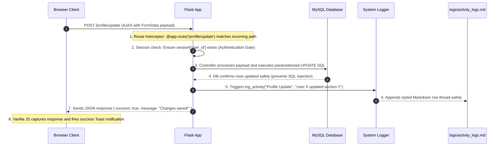

# TalentKhoj Developer Architecture & Operations Guide

Welcome to the **TalentKhoj Developer Handbook**. This guide is designed specifically for our team to understand how our core application architecture, request routing, database models, authentication engine, and configuration pipelines interact.

---

## 🗺️ 1. Core Architectural Paradigm

TalentKhoj is built as a **layered Model-View-Controller (MVC)** web application. Instead of separating layers into many complex files, it uses a modular, consolidated framework optimized for scalability:

```text
┌────────────────────────────────────────────────────────────────────────┐
│                        1. PRESENTATION LAYER                           │
│        (Jinja2 Templates, Browser Clients & Web View Engines)          │
└───────────────────────────────────┬────────────────────────────────────┘
                                    │
                                    │ HTTP Requests / Asynchronous AJAX
                                    ▼
┌────────────────────────────────────────────────────────────────────────┐
│                          2. ROUTING LAYER                              │
│       (@app.route Decorators, Session Validators & Middlewares)        │
└───────────────────────────────────┬────────────────────────────────────┘
                                    │
                                    │ Maps URL to Python Controller
                                    ▼
┌────────────────────────────────────────────────────────────────────────┐
│                          3. CONTROLLER LAYER                           │
│      (Business Logic, Payload Validation, Route-to-Controller Flow)    │
└───────────┬───────────────────────┬───────────────────────┬────────────┘
            │                       │                       │
            │ Dispatches emails     │ Logs Operations       │ Queries DB
            ▼                       ▼                       ▼
┌───────────────────────┐ ┌───────────────────────┐ ┌────────────────────┐
│   4A. SERVICE LAYER   │ │  4B. LOGGING UTILITY  │ │  4C. DATABASE D.A.L│
│ (SMTP & Flask-Mail)   │ │ (activity_logs.md)    │ │ (database.py D.B.) │
└───────────────────────┘ └───────────────────────┘ └────────────────────┘
```

### The Separation of Concerns
1. **The Presentation Layer (Views)**: Our Jinja2 HTML templates render responsive layouts based on dynamic states.
2. **The Logic & Routing Layer (Controllers)**: Handled by decorators inside the application. They intercept incoming requests, validate payloads, query database systems, and orchestrate responses.
3. **The Data Access Layer (Models)**: Handled inside database schemas, ensuring safe thread-safe pooling and clean execution of parameterized transactions.

---

## 🔌 2. How Routing & Controllers Work (The Request Life-Cycle)

Routing acts as the entry door to the website, mapping a URL to a specific Python controller function. Below is the exact step-by-step working procedure of a user request from the browser down to the database:

### Sequence of an AJAX Action (e.g., Asynchronous Profile Update)



---

## 🔐 3. How Authentication & Sessions Work

Security is built on cryptographically secure hashing, time-limited verification tokens, and server-side state tracking.

### A. The Signup & Login Password Hashing Pipeline
- **Registration Procedure**: When a user registers a new account, the plain-text password goes through an encryption pipeline. It is hashed using a secure key-derivation standard (PBKDF2-SHA256). The generated hash contains a unique salt and is written to the database, ensuring plain-text passwords are never stored.
- **Login Verification Procedure**: During login, the controller retrieves the user's encrypted password hash from the database based on the email provided. The controller then executes a secure cryptographic match between the incoming raw login password and the saved database hash. If they resolve correctly, access is granted.

### B. Session State Storage
- **Establishment Procedure**: On successful authentication, the server generates a signed session cookie. This cookie contains user metadata (such as the user's primary key, profile picture URL, and account type) and is sent to the client browser.
- **Verification Procedure**: On every subsequent page request, the browser sends this signed cookie back. The server verifies its cryptographic signature to confirm authenticity, checks whether the session is valid, and dynamically determines which dashboard (Candidate or Company) should be rendered.

### C. Email Verification & Password Recovery Tokens
1. **Generation Procedure**: When email verification or a password reset is requested, the controller generates a cryptographically secure, high-entropy token. This token acts as a unique one-time URL variable.
2. **Database Recording Procedure**: The token is saved in the user's database record alongside a specific expiration timestamp. The system enforces that email verification links expire strictly within 24 hours, while password reset links expire within 1 hour.
3. **Validation & Expiry Procedure**: When the user clicks the link, the controller retrieves the token from the URL, queries the database for a matching record, and checks the current system timestamp. If the token is found and the current time is before the expiration timestamp, the action succeeds, the state is committed (e.g. flagging the email as verified or updating the password), and the token is immediately cleared to prevent reuse.

---

## 💾 4. Database Schema & Data Pipeline

TalentKhoj uses dynamic relational mappings to support robust resume management and screening wizards:

```mermaid
erDiagram
    users {
        int id PK "Auto Increment"
        string full_name "User's Registered Name"
        string email UNIQUE "Lowercase Validated Email"
        string password_hash "Werkzeug Hash"
        string account_type "candidate OR company"
        string cv_path "Static Path to active PDF/Word CV"
        text cv_data "JSON serialized educational & career arrays"
    }
    jobs {
        int id PK "Auto Increment"
        int company_id FK "References users.id"
        string title "Opportunity Title"
        string type "Job / Internship / Event"
        string location "Geographic City Location"
        text questions "JSON serialized list of screening questions"
    }
    applications {
        int id PK "Auto Increment"
        int job_id FK "References jobs.id"
        int user_id FK "References users.id"
        text answers "JSON list of custom candidate answers"
        string status "applied / rejected"
        timestamp created_at
    }
    users ||--o{ jobs : "posts"
    users ||--o{ applications : "submits"
    jobs ||--o{ applications : "receives"
```

### Dynamic Data Structures (No Database Bloat)
- **Career Portfolios**: Instead of creating separate database tables for school histories, certificates, and work experience, all dynamic resume metadata is compiled into a single unified JSON schema stored inside the user's record. The controller decodes this JSON string on-the-fly to populate the CV form.
- **Custom Screening Questions**: Recruiters add job questions dynamically when posting a role. These questions are converted into a JSON array and saved in the job's record.
- **Screening Submissions**: Candidates respond in custom text fields during application. Their answers are automatically packaged as a list of question-and-answer pairs, serialized to JSON, and stored directly in the application record.

---

## ⚙️ 5. Setting Up Environment Configurations (`.env`)

Every developer must set up a local `.env` configuration file in the root workspace folder to feed backend environments:

```bash
# =================================================================
# TalentKhoj Global Environment Configurations
# =================================================================

# 1. Flask Security Key (Protects Session Signatures)
SECRET_KEY=your_cryptographically_secure_random_key

# 2. Local MySQL Database Connection
MYSQL_HOST=localhost
MYSQL_USER=root
MYSQL_PASSWORD=your_mysql_database_password
MYSQL_DATABASE=talent_khoj

# 3. Google OAuth 2.0 Credentials (For Social Integrations)
GOOGLE_CLIENT_ID=your-google-oauth-client-id.apps.googleusercontent.com
GOOGLE_CLIENT_SECRET=GOCSPX-your-google-client-secret

# 4. SMTP Transactional Mail configurations
# Generates automated verification and password-recovery messages.
MAIL_USERNAME=your_gmail_address@gmail.com
MAIL_PASSWORD=your_secure_16_digit_app_password
```

---

## 🚀 6. Agile Sprint 3 Developer Implementation Guide

This section outlines the blueprints, database changes, routes, and step-by-step workflow requirements for **Sprint 3**. Use these patterns to keep implementations consistent across branches.

---

### 📋 Sprint 3 Core Backlog Architecture Mapping

```mermaid
graph TD
    classDef main fill:#f9fbfd,stroke:#2456ff,stroke-width:2px;
    classDef sub fill:#f0f4ff,stroke:#2456ff,stroke-dasharray: 5 5;
    
    A[Sprint 3 Backlog] --> B1[US 1: Applicant ATS Board]
    A --> B2[US 2: Track & Bookmark Jobs]
    A --> B3[US 3: Company Events Engine]
    A --> B4[US 4: Company Review System]
    A --> B5[US 5: Admin Content Moderator]
    
    B1 ::: main
    B2 ::: main
    B3 ::: main
    B4 ::: main
    B5 ::: main
```

---

### 1. User Story #1: applicant ATS board & filtering (Prasiddha Gautam)
* **Goal**: Enable companies to manage applicants using a visual stage-based (Kanban) system and filter them by qualifications (skills, location, experience).

#### A. Database Schema
Ensure the `applications` table supports modern dynamic statuses.
- Existing status: `ENUM('applied', 'reviewed', 'shortlisted', 'rejected')` (perfect for board columns).
- Ensure columns are indexed for fast joins:
```sql
ALTER TABLE applications ADD INDEX idx_status (status);
```

#### B. Backend API Routes (`app.py` or new blueprint)
1. **GET `/dashboard/ats`**: Render the recruiter ATS view. Fetches all applications for the active company's posted jobs.
2. **POST `/dashboard/ats/update-status`**: AJAX route to move candidates between columns.
   - **Payload**: `{ "application_id": 12, "status": "shortlisted" }`
   - **Response**: `{ "success": true, "message": "Applicant status updated." }`
3. **GET `/dashboard/ats/filter`**: Filter applicants via query strings.
   - **Query Params**: `/dashboard/ats/filter?skills=Python&location=Kathmandu&experience=Entry`
   - **Response**: HTML fragments (for dynamic injection) or clean serialized JSON.

#### C. Step-by-Step Implementation Workflow
1. **Kanban UI**: Build a responsive grid with four columns: **Applied**, **Reviewed**, **Shortlisted**, **Rejected**.
2. **Drag-and-Drop / Button Move**: Implement interactive status moving. Add a dropdown button `Move Stage` or use a lightweight drag-and-drop JavaScript utility to fire the `POST /dashboard/ats/update-status` route.
3. **Qualification Filters**: Add a filter bar on top with inputs for **Skills**, **Experience Level**, and **Location**. Perform simple SQL string joins linking `applications` -> `users` (checking JSON attributes inside `cv_data` or the standard `users.skills` columns).
4. **Activity Logging**: Log status movements thread-safely:
   `log_activity("ATS Update", "Applicant ID X moved to shortlisted by Company Y")`.

---

### 2. User Story #2: track job applications & bookmark jobs (Rudra Lama)
* **Goal**: Allow candidates to view application statuses on a timeline, and bookmark jobs they are interested in to apply later.

#### A. Database Schema
Create a new `bookmarks` table to establish a many-to-many relationship:
```sql
CREATE TABLE IF NOT EXISTS bookmarks (
    id INT AUTO_INCREMENT PRIMARY KEY,
    user_id INT NOT NULL,
    job_id INT NOT NULL,
    created_at TIMESTAMP DEFAULT CURRENT_TIMESTAMP,
    FOREIGN KEY (user_id) REFERENCES users(id) ON DELETE CASCADE,
    FOREIGN KEY (job_id) REFERENCES jobs(id) ON DELETE CASCADE,
    UNIQUE KEY unique_user_job_bookmark (user_id, job_id)
) ENGINE=InnoDB DEFAULT CHARSET=utf8mb4;
```

#### B. Backend API Routes
1. **GET `/dashboard/applications`**: Render candidate's applied timeline.
2. **POST `/dashboard/jobs/bookmark/<int:job_id>`**: AJAX toggle endpoint to bookmark/unbookmark a job.
   - **Response**: `{ "success": true, "bookmarked": true/false, "message": "..." }`
3. **GET `/dashboard/bookmarks`**: Render the list of bookmarked jobs.

#### C. Step-by-Step Implementation Workflow
1. **Application Timeline View**: Design a vertical timeline using premium SVG status circles (e.g. green for shortlisted, yellow for reviewed, red for rejected).
2. **Bookmark Button**: Add a modern bookmark ribbon/star icon on each job card in `dashboard_search.html`.
3. **Asynchronous JS Toggle**: Clicking the icon fires `POST /dashboard/jobs/bookmark/<job_id>` dynamically, updating the icon fill color (e.g. solid blue vs outline grey) without reloading the page.

---

### 3. User Story #3: create and RSVP to events (Tejash Gupta)
* **Goal**: Allow company accounts to post events (webinars, job fairs), and individual candidates to view them and RSVP.

#### A. Database Schema
Extend the existing tables or create a new `event_rsvps` table:
- Note that `jobs` table has `opportunity_type ENUM('job', 'internship', 'event')`. We can leverage the `jobs` table for events or build a dedicated events engine.
- Recommended approach for premium event registration:
```sql
CREATE TABLE IF NOT EXISTS events (
    id INT AUTO_INCREMENT PRIMARY KEY,
    company_id INT NOT NULL,
    title VARCHAR(255) NOT NULL,
    description TEXT NOT NULL,
    event_date DATETIME NOT NULL,
    location VARCHAR(255) NOT NULL, -- e.g., 'Virtual / Zoom' or physical address
    banner_url VARCHAR(255) DEFAULT NULL,
    created_at TIMESTAMP DEFAULT CURRENT_TIMESTAMP,
    FOREIGN KEY (company_id) REFERENCES companies(id) ON DELETE CASCADE
) ENGINE=InnoDB DEFAULT CHARSET=utf8mb4;

CREATE TABLE IF NOT EXISTS event_rsvps (
    id INT AUTO_INCREMENT PRIMARY KEY,
    event_id INT NOT NULL,
    user_id INT NOT NULL,
    created_at TIMESTAMP DEFAULT CURRENT_TIMESTAMP,
    FOREIGN KEY (event_id) REFERENCES events(id) ON DELETE CASCADE,
    FOREIGN KEY (user_id) REFERENCES users(id) ON DELETE CASCADE,
    UNIQUE KEY unique_event_user (event_id, user_id)
) ENGINE=InnoDB DEFAULT CHARSET=utf8mb4;
```

#### B. Backend API Routes
1. **GET `/dashboard/events`**: Lists all events. Dynamic buttons show if a candidate has RSVP'd or if the company owns the event.
2. **POST `/dashboard/events/create`**: Form submission for companies to add new events.
3. **POST `/dashboard/events/rsvp/<int:event_id>`**: AJAX toggle to RSVP to an event.

#### C. Step-by-Step Implementation Workflow
1. **Creation Interface**: Design an event form for companies with fields for **Title**, **Description**, **Date/Time**, **Location**, and a **Banner Image**.
2. **RSVP Action**: Candidates see a dynamic **"RSVP / Attend"** button on event cards.
3. **Email Notification**: On RSVP success, trigger transactional emails:
   `EmailService.send_email(user["email"], "RSVP Confirmed: " + event["title"], html_content)`.

---

### 4. User Story #4: company review and rating system (Reshma Bhurtel)
* **Goal**: Establish a review system where candidates can leave anonymous/public comments and 1-5 star ratings on company pages.

#### A. Database Schema
```sql
CREATE TABLE IF NOT EXISTS company_reviews (
    id INT AUTO_INCREMENT PRIMARY KEY,
    user_id INT NOT NULL,          -- The candidate writing the review
    company_id INT NOT NULL,       -- The company profile receiving the review
    rating INT CHECK (rating BETWEEN 1 AND 5),
    review_text TEXT NOT NULL,
    is_anonymous TINYINT(1) DEFAULT 0,
    created_at TIMESTAMP DEFAULT CURRENT_TIMESTAMP,
    FOREIGN KEY (user_id) REFERENCES users(id) ON DELETE CASCADE,
    FOREIGN KEY (company_id) REFERENCES companies(id) ON DELETE CASCADE
) ENGINE=InnoDB DEFAULT CHARSET=utf8mb4;
```

#### B. Backend API Routes
1. **GET `/company/<int:user_id>`**: Update this public route to display the average star rating and show all approved reviews.
2. **POST `/company/<int:company_id>/review`**: Controller endpoint to validate and insert a new candidate review.
   - Requires login check and ensuring the user's role is `individual`.

#### C. Step-by-Step Implementation Workflow
1. **Star UI Component**: Design interactive star input widgets (using CSS hover scales and SVG stars) from 1 to 5.
2. **Dynamic Review List**: Aggregate average scores using SQL:
   `SELECT AVG(rating) as avg_rating, COUNT(id) as total_reviews FROM company_reviews WHERE company_id = %s`.
3. **Anonymity Flag**: Provide a toggle checkbox ` "Anonymous Candidate"  user.full_name `.

---

### 5. User Story #5: content moderation & admin dashboard (Bhupendra Bahadur Saud)
* **Goal**: A dedicated administration panel `/admin` allowing moderators to monitor, hide, delete, or flag jobs, reviews, and companies.

#### A. Authentication & Gatekeeping
To maintain strict secure routing, ensure `users` table has an admin flag or query checks.
- Add an `is_admin` column to the `users` table:
```sql
ALTER TABLE users ADD COLUMN is_admin TINYINT(1) NOT NULL DEFAULT 0;
```
Create a secure decorator inside `app.py`:
```python
def admin_required(f):
    @wraps(f)
    def decorated(*args, **kwargs):
        if not session.get("user_id"):
            return redirect(url_for("login"))
        # Query db to verify is_admin
        conn = get_db()
        with conn.cursor() as cursor:
            cursor.execute("SELECT is_admin FROM users WHERE id = %s", (session["user_id"],))
            user = cursor.fetchone()
        if not user or not user.get("is_admin"):
            flash("Unauthorized access.", "error")
            return redirect(url_for("home"))
        return f(*args, **kwargs)
    return decorated
```

#### B. Backend API Routes
1. **GET `/admin`**: Central dashboard loading metrics (Total Users, Flagged Jobs, Total Reviews).
2. **POST `/admin/job/<int:job_id>/delete`**: Hard delete or soft-flag jobs.
3. **POST `/admin/review/<int:review_id>/delete`**: Remove toxic or spam company reviews.
4. **POST `/admin/user/<int:user_id>/ban`**: Suspend user/company accounts.

#### C. Step-by-Step Implementation Workflow
1. **Dashboard Layout**: Build a clean table-based administration workspace listing **Recent Job Posts**, **User Accounts**, and **Company Reviews**.
2. **Moderate Actions**: Add Red Action Buttons with confirm dialogs:
   `onclick="return confirm('Are you sure you want to delete this content?');"`.
3. **Thread-Safe Audit Logs**: Write to system activity logs whenever admin actions occur:
   `log_activity("ADMIN ACTION", "Admin suspended User ID X and deleted Review Y")`.

```

### Configuration Setup Working Procedure
- **Security Procedure**: The `.env` file contains sensitive security credentials and database passwords. It is explicitly excluded from the Git repository using `.gitignore` to prevent leaks.
- **Flask Session Encryption Procedure**: The `SECRET_KEY` is loaded by the application at startup and is used to cryptographically sign session cookies. This prevents users from altering cookie data on their client browsers.
- **SMTP Authentication Procedure**: To send automated verification and password reset emails via Gmail SMTP, developers must generate a secure **16-digit App Password** inside their Google Account Security settings and paste it into the `MAIL_PASSWORD` field.
