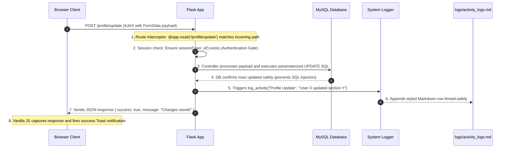

# TalentKhoj Developer Architecture & Operations Guide

Welcome to the **TalentKhoj Developer Handbook**. This guide is designed specifically for our team to understand how our core application architecture, request routing, database models, authentication engine, and configuration pipelines interact.

---

## 🗺️ 1. Core Architectural Paradigm

TalentKhoj is built as a **layered Model-View-Controller (MVC)** web application. Instead of separating layers into many complex files, it uses a modular, consolidated framework optimized for scalability:

```text
┌────────────────────────────────────────────────────────────────────────┐
│                        1. PRESENTATION LAYER                           │
│        (Jinja2 Templates, Browser Clients & Web View Engines)          │
└───────────────────────────────────┬────────────────────────────────────┘
                                    │
                                    │ HTTP Requests / Asynchronous AJAX
                                    ▼
┌────────────────────────────────────────────────────────────────────────┐
│                          2. ROUTING LAYER                              │
│       (@app.route Decorators, Session Validators & Middlewares)        │
└───────────────────────────────────┬────────────────────────────────────┘
                                    │
                                    │ Maps URL to Python Controller
                                    ▼
┌────────────────────────────────────────────────────────────────────────┐
│                          3. CONTROLLER LAYER                           │
│      (Business Logic, Payload Validation, Route-to-Controller Flow)    │
└───────────┬───────────────────────┬───────────────────────┬────────────┘
            │                       │                       │
            │ Dispatches emails     │ Logs Operations       │ Queries DB
            ▼                       ▼                       ▼
┌───────────────────────┐ ┌───────────────────────┐ ┌────────────────────┐
│   4A. SERVICE LAYER   │ │  4B. LOGGING UTILITY  │ │  4C. DATABASE D.A.L│
│ (SMTP & Flask-Mail)   │ │ (activity_logs.md)    │ │ (database.py D.B.) │
└───────────────────────┘ └───────────────────────┘ └────────────────────┘
```

### The Separation of Concerns
1. **The Presentation Layer (Views)**: Our Jinja2 HTML templates render responsive layouts based on dynamic states.
2. **The Logic & Routing Layer (Controllers)**: Handled by decorators inside the application. They intercept incoming requests, validate payloads, query database systems, and orchestrate responses.
3. **The Data Access Layer (Models)**: Handled inside database schemas, ensuring safe thread-safe pooling and clean execution of parameterized transactions.

---

## 🔌 2. How Routing & Controllers Work (The Request Life-Cycle)

Routing acts as the entry door to the website, mapping a URL to a specific Python controller function. Below is the exact step-by-step working procedure of a user request from the browser down to the database:

### Sequence of an AJAX Action (e.g., Asynchronous Profile Update)



---

## 🔐 3. How Authentication & Sessions Work

Security is built on cryptographically secure hashing, time-limited verification tokens, and server-side state tracking.

### A. The Signup & Login Password Hashing Pipeline
- **Registration Procedure**: When a user registers a new account, the plain-text password goes through an encryption pipeline. It is hashed using a secure key-derivation standard (PBKDF2-SHA256). The generated hash contains a unique salt and is written to the database, ensuring plain-text passwords are never stored.
- **Login Verification Procedure**: During login, the controller retrieves the user's encrypted password hash from the database based on the email provided. The controller then executes a secure cryptographic match between the incoming raw login password and the saved database hash. If they resolve correctly, access is granted.

### B. Session State Storage
- **Establishment Procedure**: On successful authentication, the server generates a signed session cookie. This cookie contains user metadata (such as the user's primary key, profile picture URL, and account type) and is sent to the client browser.
- **Verification Procedure**: On every subsequent page request, the browser sends this signed cookie back. The server verifies its cryptographic signature to confirm authenticity, checks whether the session is valid, and dynamically determines which dashboard (Candidate or Company) should be rendered.

### C. Email Verification & Password Recovery Tokens
1. **Generation Procedure**: When email verification or a password reset is requested, the controller generates a cryptographically secure, high-entropy token. This token acts as a unique one-time URL variable.
2. **Database Recording Procedure**: The token is saved in the user's database record alongside a specific expiration timestamp. The system enforces that email verification links expire strictly within 24 hours, while password reset links expire within 1 hour.
3. **Validation & Expiry Procedure**: When the user clicks the link, the controller retrieves the token from the URL, queries the database for a matching record, and checks the current system timestamp. If the token is found and the current time is before the expiration timestamp, the action succeeds, the state is committed (e.g. flagging the email as verified or updating the password), and the token is immediately cleared to prevent reuse.

---

## 💾 4. Database Schema & Data Pipeline

TalentKhoj uses dynamic relational mappings to support robust resume management and screening wizards:

```mermaid
erDiagram
    users {
        int id PK "Auto Increment"
        string full_name "User's Registered Name"
        string email UNIQUE "Lowercase Validated Email"
        string password_hash "Werkzeug Hash"
        string account_type "candidate OR company"
        string cv_path "Static Path to active PDF/Word CV"
        text cv_data "JSON serialized educational & career arrays"
    }
    jobs {
        int id PK "Auto Increment"
        int company_id FK "References users.id"
        string title "Opportunity Title"
        string type "Job / Internship / Event"
        string location "Geographic City Location"
        text questions "JSON serialized list of screening questions"
    }
    applications {
        int id PK "Auto Increment"
        int job_id FK "References jobs.id"
        int user_id FK "References users.id"
        text answers "JSON list of custom candidate answers"
        string status "applied / rejected"
        timestamp created_at
    }
    users ||--o{ jobs : "posts"
    users ||--o{ applications : "submits"
    jobs ||--o{ applications : "receives"
```

### Dynamic Data Structures (No Database Bloat)
- **Career Portfolios**: Instead of creating separate database tables for school histories, certificates, and work experience, all dynamic resume metadata is compiled into a single unified JSON schema stored inside the user's record. The controller decodes this JSON string on-the-fly to populate the CV form.
- **Custom Screening Questions**: Recruiters add job questions dynamically when posting a role. These questions are converted into a JSON array and saved in the job's record.
- **Screening Submissions**: Candidates respond in custom text fields during application. Their answers are automatically packaged as a list of question-and-answer pairs, serialized to JSON, and stored directly in the application record.

---

## ⚙️ 5. Setting Up Environment Configurations (`.env`)

Every developer must set up a local `.env` configuration file in the root workspace folder to feed backend environments:

```bash
# =================================================================
# TalentKhoj Global Environment Configurations
# =================================================================

# 1. Flask Security Key (Protects Session Signatures)
SECRET_KEY=your_cryptographically_secure_random_key

# 2. Local MySQL Database Connection
MYSQL_HOST=localhost
MYSQL_USER=root
MYSQL_PASSWORD=your_mysql_database_password
MYSQL_DATABASE=talent_khoj

# 3. Google OAuth 2.0 Credentials (For Social Integrations)
GOOGLE_CLIENT_ID=your-google-oauth-client-id.apps.googleusercontent.com
GOOGLE_CLIENT_SECRET=GOCSPX-your-google-client-secret

# 4. SMTP Transactional Mail configurations
# Generates automated verification and password-recovery messages.
MAIL_USERNAME=your_gmail_address@gmail.com
MAIL_PASSWORD=your_secure_16_digit_app_password
```

### Configuration Setup Working Procedure
- **Security Procedure**: The `.env` file contains sensitive security credentials and database passwords. It is explicitly excluded from the Git repository using `.gitignore` to prevent leaks.
- **Flask Session Encryption Procedure**: The `SECRET_KEY` is loaded by the application at startup and is used to cryptographically sign session cookies. This prevents users from altering cookie data on their client browsers.
- **SMTP Authentication Procedure**: To send automated verification and password reset emails via Gmail SMTP, developers must generate a secure **16-digit App Password** inside their Google Account Security settings and paste it into the `MAIL_PASSWORD` field.
